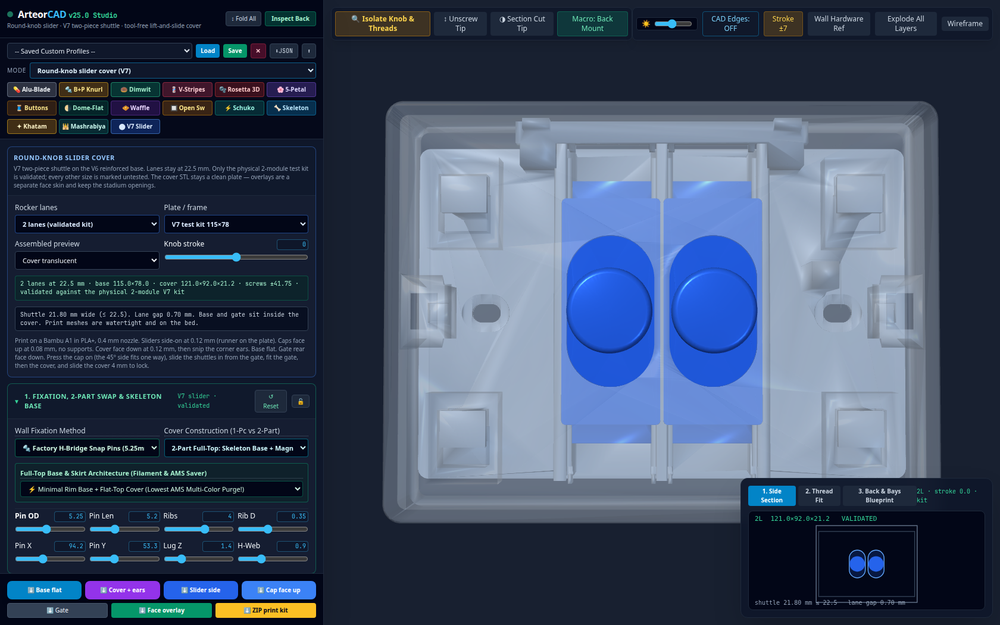
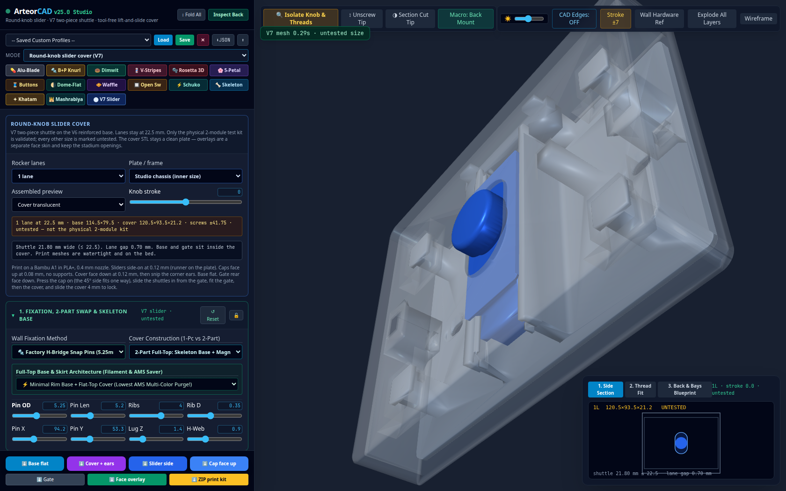
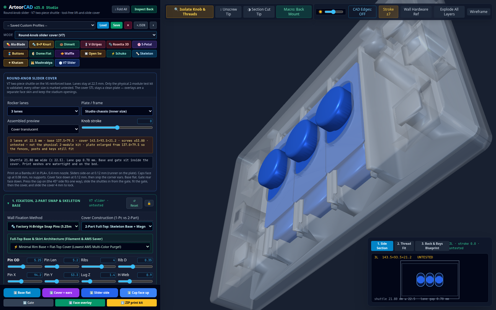
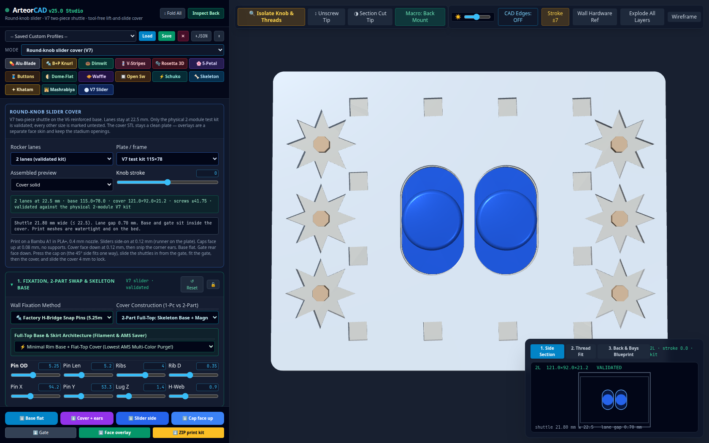

# ArteorCAD v25 Studio

ArteorCAD is a browser tool for designing 3D-printed wall switch covers. The page is `index.html`. It builds the cover parametrically with three.js, shows it in an orbit view, and downloads binary STL files with the mesh shifted so its lowest point sits on Z = 0.

The **Mode** menu adds a second designer, **Round-knob slider cover (V7)**. That mode is the physically iterated two-module slider (V6 base and gate, V7 cover and two-piece shuttle), sized for 1–4 lanes. Its geometry lives in `v7-slider.js` and uses the same manifold kernel as the original CAD. The standard plate — wall-box screws, the Arteor pin bridge, slip-over, and the Middle Eastern overlays — is unchanged when Mode is **Standard plate**.

The product version lives in one place, `APP_VERSION` (`v25`), in the script at the top of `index.html`. That token is the page title, every STL filename, the JSON setup download, and the suggested name when you save a setup. The green header badge is the same token plus `.0 Studio`, so it reads **v25.0 Studio**.

## Run it

Tailwind and three.js **0.128.0** (OrbitControls, STLExporter, STLLoader, and OBJLoader) are loaded from CDNs. The browser needs a network connection.

Open `index.html` directly, or from this folder:

```bash
python3 -m http.server
```

Then open `http://localhost:8000/`.

The slider mode loads `v7-slider.js` and manifold from a CDN, so it needs that server (or GitHub Pages). Opening `index.html` as a file still runs the standard plate. The slider kernel will not start from a `file://` URL.

On startup the **Alu-Blade** preset is applied. The chassis readout is then **119.5 × 84.5 mm**: 3-module inner size 114.5 × 79.5 mm and wall 2.5 mm. That preset writes a 0.8 mm corner, and the corner slider steps by 0.5 mm, so the control settles on 1 mm. That is still under 1.2 mm, which is why the outer size does not grow past the wall thickness.

## Round-knob slider cover

Choose **Round-knob slider cover (V7)** in the Mode menu, or press **⬤ V7 Slider**. The footer buttons switch to the print parts. The standard plate buttons come back when you return to Standard plate.

The mechanism is Carl's V7 kit. Protected coupon values are fixed and are not sliders: runner 19.8×59×2.4 mm with the underside at installed Z 11.3, cams 16 mm wide, toe / knee / end at 19.5 / 28 / 29.5, cam drop 5.3 mm, vertical gap 0.35 mm, stroke ±7 mm, track width 20.9 mm. Lanes repeat at 22.5 mm, centred, so two lanes sit at ±11.25. Each lane stays inside the 22.5 mm Arteor rocker width (the assembled shuttle is 21.8 mm wide). Nothing in the joint is a loose part: the cap presses onto a tenon with four crush ribs.

| Part | What it is | Print orientation | Layer |
| --- | --- | --- | --- |
| Base | V6 reinforced track. Outer fences are 2.3 mm with a 45° foot, the centre divider is 1.6 mm, and the screw slots are 83.5 mm apart on the test kit. | Flat on the bed | 0.12 mm |
| Cover | One plate, 121×92×21.2 mm on the test kit. Stadium openings only (19.2×33.2 per lane), 0.5 mm eased face edge, solid keepers fused to the side wall. | Face down. Snip off the corner ears after printing. | 0.12 mm |
| Slider | Runner, cams, skis and the shield fill, plus the tenon. One file; print one per lane. | Side-on, runner edge on the plate | 0.12 mm |
| Cap | Shield 21.8×50, round 45° neck Ø14.5→Ø18.4, puck Ø18.4 with a 1.6 mm soft edge and a 0.6 mm dome. | Face up, shield on the plate. No supports. | 0.08 mm |
| Gate | The V4 stop gate, unchanged. | Rear face down | 0.12 mm |

Printer notes from the validated kit: Bambu A1, 0.4 mm nozzle, PLA+. Caps use 0.08 mm because the 0.6 mm dome needs the finer layers. Sliders use the 0.12 mm profile; supports stay off the runner underside, the cam ramps and the wing undersides.

**Rocker lanes** is 1, 2, 3 or 4. **Plate / frame** is either the V7 test kit (base 115×78, cover 121×92×21.2, screws at ±41.75) or the studio chassis. Studio frame uses the chassis inner width and height, and the screw pitch already on the page (83.5 mm on a 3-module chassis, 106 mm on a 4-module chassis). If that plate is too narrow for the fences, corner posts and keys, the mesh grows to the minimum that still fits and the status line says the plate was enlarged.

Only 2 lanes on the 115×78 kit is **validated** against the physical part. Every other combination is labelled **untested** in the panel. The status line is green for the kit and amber otherwise.

The assembled view shows the base, gate and shuttles in the installed frame (runner underside at Z 11.3). **Assembled preview** sets the cover solid, translucent, or hidden. **Knob stroke** runs ±7 mm, and **Stroke ±7** flips between the ends. Explode lifts the cover. The cover colour is Body A, the base is Stripe/Base B, and the knobs follow Knob Stem. Multi-Color Knobs tints each lane.

Overlays apply to the face only. The printed cover STL is still the clean plate with the stadium openings and the eased edge. A face overlay is a separate STL, inset 0.6 mm from the eased arris, with the same openings cut out — including Khatam, Mashrabiya, Girih and the cedar frieze. It is not fused into the cover, so it cannot close a slot or add a feature inside the mechanism.

**⬇ ZIP print kit** downloads every print STL plus `PRINT.txt` (quantity, orientation, and the lock/unlock sequence). Each button downloads that one piece already in its print orientation, lowest point on Z = 0. Slider and cap files are one part each; print as many as there are lanes.

`npm run test:v7` builds the kit with manifold-3d 3.5.4 and compares the 2-lane STLs with `test/fixtures/v7/`. Bounding boxes match, and volume error on those files is numerical noise (under 10⁻⁷ %). The same run checks that 1-, 3- and 4-lane meshes, on both the test-kit plate and the studio 3- and 4-module chassis, are single watertight solids, sit on the bed, keep the shuttle inside 22.5 mm, and fit the base and gate inside the cover.







A face overlay stays outside the mechanism. Khatam on the solid cover keeps both stadium openings:



## Mounting

**Wall Fixation Method** is one of three modes. The page shows only that mode’s controls.

### Factory H-Bridge Snap Pins (`hpins`, the default)

Four ribbed pins on a connected web: the pin-bridge mount. Defaults are pin OD 5.25 mm, length 5.2 mm, 4 ribs, rib depth 0.35 mm, spacing 94.2 mm in X and 53.3 mm in Y, lug thickness 1.4 mm, and H-web 0.9 mm.

### Universal 2-Screw Slotted Ears (`screwtabs`)

Two slotted ears for wall-box screws. Defaults are a screw pitch of 83.5 mm, a slot diameter of 4.2 mm, and an ear thickness of 2.4 mm. Each slot is a vertical pill (the hole is the slot diameter wide and 3.2 mm taller, with semicircular ends).

### Slip-Over Cavity + Snap-Lip (`slipover`)

A cover that sits on an existing plate. It builds a cavity over the inner opening and an inward snap lip. Defaults are a lip bite of 0.65 mm, a lip height of 2.2 mm, and lips on the top and bottom edges only. The lip control can switch that to all four walls. This mode does not add H-pins or screw ears. A lip bite at or below 0.02 mm adds no lip.

Cover construction is separate from the wall mount. The cover can be one solid piece, or a two-part cover (an inlay, or a full top over the base) held by snap catches or by four magnet pockets. The opening preset is a two-part full top with magnet pockets and a minimal rim base. The control default before that preset runs is a full-top snap cover on the minimal skeleton base. Skeleton wrap is not used for slip-over; that mount keeps the cavity shell.

## Frame sizes

**Legrand Chassis Capacity** writes sizes when you change 3-module / 4-module. A locked fixation or chassis section is left alone.

| Choice | Inner width | Pin spacing X | Screw pitch |
| --- | --- | --- | --- |
| 3-module standard | 114.5 mm, or 116.0 mm if slip-over is the current mount | 94.2 mm | 83.5 mm |
| 4-module wide | 137.0 mm, or 138.5 mm if slip-over is the current mount | 116.7 mm | 106.0 mm |

Inner height is not changed by that menu. Its default is 79.5 mm. Wall, corner radius, face thickness, skirt, and cavity depth have their own sliders.

The label beside step 2 is the outer size. It is the inner size plus the wall thickness on each side. Outside slip-over mode, a corner radius above 1.2 mm also adds `(corner − 1.2) × 0.415` mm per side. Slip-over does not add that corner extension.

The central switch pocket is 69.8 mm wide on a 3-module chassis and 92.3 mm wide on a 4-module chassis. Pocket height is the module height plus 2 mm, and at least 47.4 mm. Module pitch defaults to 22.5 mm and module height to 45.2 mm. You can place 0–4 switches, and an outlet labeled **1M Outlet (22.5×45)** or **2M Schuko (45×45)**, on the left, right, or center.

A rectangular outlet cut is the module pitch (times two for Schuko) plus 0.2 mm, by the module height. Schuko **Cover Bezel** mode cuts a 39.5 mm round well instead. The 1M cover-bezel option cuts two 5.4 mm pin holes, 9.5 mm above and below center. Uncovered switches open a rectangle of `(pitch + 0.2)` by the module height. Covered switches use the slot width, height, and shape (pill, rectangle, or circle).

When the mix of covered switches and outlets changes, cavity depth is rewritten unless the chassis section is locked: 11.0 mm while any switch is covered, 5.6 mm for a cover-bezel outlet with no covered switch, otherwise `max(2.4, 5.2 + 0.43 − face thickness)` mm.

## Parts the STL buttons export

These buttons are the **standard plate**. In the slider mode the footer is the print kit described above (base, cover with ears, slider, cap, gate, face overlay, ZIP).

Each button downloads a binary STL and drops the mesh onto Z = 0. Names use `APP_VERSION` (`v25` today). `fixMode` is `hpins`, `screwtabs`, or `slipover`. `coverBuild` is the cover-construction value (`fulltop_snaps` in the control default, `fulltop_magnets` after the opening Alu-Blade preset).

| Button | File |
| --- | --- |
| Part 1: Base | `Arteor_v25_Part1_SkeletonBase_<fixMode>_<coverBuild>.stl` |
| Part 2: Bare Cover | `Arteor_v25_Part2_BareCover_NoOverlay_<coverBuild>.stl` |
| Waffle / Overlay | `Arteor_v25_AMS_Overlay_<overlay style>_READY.stl` |
| Cover + Overlay | `Arteor_v25_Part2_CoverWithOverlay_<coverBuild>.stl` |
| STL: Stem (+Thread) | `Arteor_v25_Stem_M<stud Ø>_PositiveThread_READY.stl` |
| STL: Tip (-Thread) | `Arteor_v25_Tip_<tip style>_<stud Ø + tolerance>mm_NegativeThread_READY.stl` |
| Full Assembly STL | `Arteor_v25_FullAssembly_<coverBuild>.stl` |

- **Part 1** is the chassis (mount, base, and snap or magnet features).
- **Bare cover** is the faceplate and any bubble geometry, without the 3D overlay, so the top stays flat for a separate overlay you glue on.
- **Waffle / Overlay** is only the overlay. The name uses the overlay menu value, including `none`.
- **Cover + Overlay** is the faceplate, bubbles, and overlay in one mesh.
- **Full assembly** is the chassis, faceplate, bubbles, and overlay. It does not include the knob.
- The stem name prints the stud diameter to one decimal place. The tip name prints stud diameter plus thread tolerance to two decimal places. Defaults are a 4.0 mm stud and 0.35 mm tolerance.
- A screw joint adds a helical stud on the stem, except on the stadium blade and the bat stick. The matching tip bore is omitted for those two as well. A one-piece joint, or the bat stick, puts the tip mesh in the stem file.

The color palette is a viewport preview. STL files have no color. A plate STL/OBJ or a knob OBJ/STL imported in this session is part of the preview and of the STL you export afterward. Those meshes are not stored in a saved setup.

## Saving and loading setups

**Save**, **Load**, and **✕** use `localStorage` under the key `arteor_cad_v24_profiles`. The key is not tied to `APP_VERSION`, so changing the version does not hide setups already saved in this browser.

**Save** asks for a name. The suggested name is `Arteor v25` plus the current time, hours and minutes. **Load** applies the name selected in the menu. **✕** deletes it. A locked section is skipped, including when a preset runs.

**⬇JSON** downloads the current controls as `arteor_v25_profile.json`. **⬆** reads a JSON file and applies it. A file that does not parse shows `Invalid JSON`. Importing does not write `localStorage` until you save.

Stored values are the designer controls (fixation, chassis, modules, plate, overlay, knob, and colors) and the multi-color knobs checkbox. Not stored: imported meshes, camera, explode / wireframe / back view, the light slider, or which sections are locked.

The buttons above the steps (Alu-Blade, B+P Knurl, Dimwit, and the rest) fill the unlocked controls with a named style.

## Printing

These are wall covers, so they can sit in sun or next to warm fittings. **PETG or ASA** is a better choice than **PLA**, which softens at a lower temperature. This page does not set a nozzle, a bed, or any other slicer profile. Export the part you want and slice that STL. The bare cover and the overlay are the pair meant to be printed separately and glued. Cover + Overlay is those same faces in one mesh.
